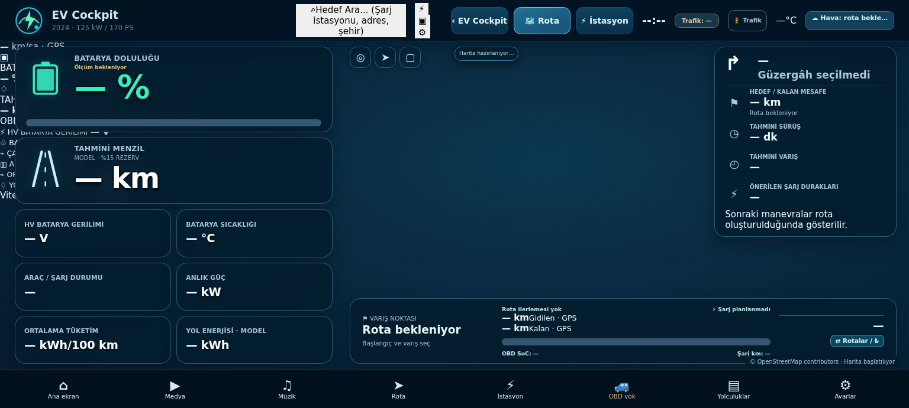
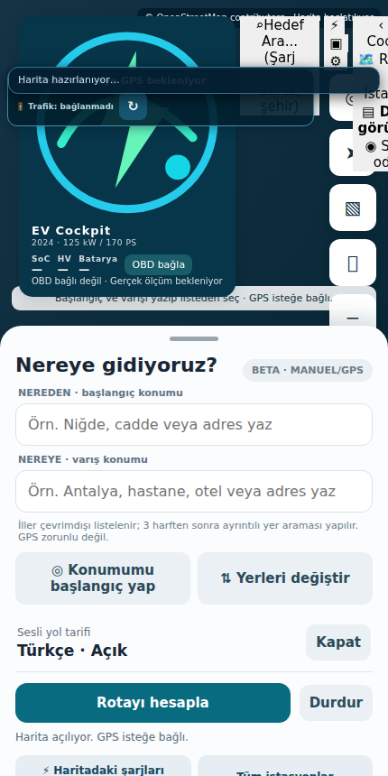
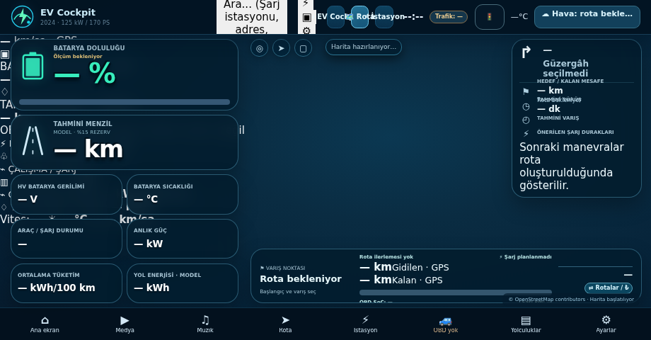

# Electric Road Companion

**Route planning, charging planning, traffic, real vehicle data, and media for electric vehicles.**

> **Development / test release.** This is an independent open-source application project, not an official product of any vehicle manufacturer. Support for all features on a physical vehicle display has not yet been verified.

## Cockpit preview

| Phone view | Compact landscape view |
| :---: | :---: |
|  |  |

These screenshots are generated from the actual application interface using **offline browser tests**. They do not show live road, GPS, OBD, or traffic data and are not evidence of real in-vehicle operation.

## Features and verification limits

| Module | Existing implementation | Important limitation |
|---|---|---|
| **Routes and maps** | A single Leaflet map, OSRM road geometry, and actual alternative routes | Public OSRM driving-time estimates are not live traffic estimates |
| **ABRP-style route planning** | An actual OSRM route, a dated EPDK CCS corridor within 5 km, and modeled charging time | Actual driving detours to DC chargers, prices, availability, and arrival SoC have not been verified in the vehicle |
| **Voice guidance** | Native Android en-US TTS with GPS accuracy checks and approximate announcement thresholds | Device/vehicle audio focus and maneuver timing on real roads have not been verified |
| **Live traffic** | Colored traffic layers and incident queries using the user's own key | Not labeled “live” until service calls and actual tile loading have been verified successfully |
| **Charging** | EPDK-based station listings, connector types, and route proximity | Real-time connector availability and current prices from every operator are not guaranteed |
| **Energy** | Explicitly labeled range and consumption models based on battery state | Modeled values are not presented as actual vehicle measurements |
| **OBD** | Authorized Bluetooth ELM327 access, validated read-only data, and freshness checks | Unverified PIDs are displayed as `—` |
| **Route progress** | A validated GPS position projected onto route geometry | Progress is not presented as measured when GPS is stale or off-route |
| **Media** | Connections to existing TV, video, music, radio, and other media engines | Third-party subscriptions and playback are not guaranteed |

### OBD and driving-data accuracy limits

| Information | Status |
|---|---|
| BMS SoC, HV voltage, battery temperature | MEB DIDs have not yet been validated for the specific vehicle; `—` |
| Remaining range / arrival SoC | Explicitly labeled model only; requires a current SoC reading or an explicit user scenario |
| Actual power (kW) / average consumption | `—` without validated PIDs; modeled consumption is not a measurement |
| Data freshness | 10 seconds per OBD field; separate GPS accuracy and age checks also apply |
| EPDK CCS | A 5 km straight-line route corridor; no guarantee of road access, detour time, or availability |
| Spoken maneuvers | Actual English TTS infrastructure exists; physical device and vehicle tests have not been performed |
| Android Auto | Unverified; no claim of confirmed in-vehicle operation |

## Optional integration with the original media APK 3.2

The user-provided `Mola-3.2(3).apk` was inspected without modification:
**version 3.2 / code 421**, package ID
`me.app.fermataX.auto.mola32.debug`, with the externally launchable activity
`me.app.fermatax.auto.PhoneLauncherActivity`.
**SHA-256:** `2cf92adf8df595c97e8ac9b5c9e0d73f64e2e3ce8601756426773f14e50f3f47`.

This integration does **not merge the applications into a single modified APK**.
No code, signature, resource, permission, media module, or interface changes are applied
to the original APK, and it is not embedded in the repository or CI.

- Both applications are installed separately and can coexist because they use different package IDs.
- **Electric Road Companion → Media → Open the original media application** opens the original application's launcher with one tap; the existing 15 media shortcuts remain available.
- Use Android Back or recent apps to return.
- An informative error is displayed if the original application is not installed.
- The original application's menus remain accessible; **no shared screen, session, cookies, player, or filesystem is claimed**.
- Launching both APKs together on a real Android phone **has not yet been verified**.
- Switching between applications in Android Auto **has not been verified**.

## APK

In GitHub **Actions**, open the latest successful workflow named **Elektrikli Yol Arkadaşım APK**, download **Artifacts → Elektrikli-Yol-Arkadasim-APK**, extract the ZIP, and install the APK on your Android phone.

New debug releases may not install over an existing version if their signatures differ. Do not uninstall the application without backing up user data. Grant device permissions only when the corresponding feature needs them.

## Usage and safety

- Routing, location, and traffic services may send network requests to external servers.
- Sample or fixed telemetry is not substituted for missing actual SoC or sensor readings.
- Charging, weather, and energy estimates are not validated vehicle sensor measurements.
- Visual media is not intended for the driver display while the vehicle is moving; driving restrictions are not removed.
- The personal traffic-service key is stored encrypted using Android Keystore. The key may still be exposed in network requests made by the running client.
- Physical phone and vehicle testing is required even when automated tests pass.

## Technical integration

The source guide's routing, OBD, and progress approach has been adapted to the existing code: one Leaflet map; valid OSRM GeoJSON road geometry; actual ELM327 events in the Android layer; and GPS projection onto the route with accuracy and freshness checks. **No second JavaScript bridge or fixed demo data is added.**

Details: [Technical integration guide](docs/ELECTRIC_ROAD_COMPANION_INTEGRATION.md).

## Licenses and data security

This preview uses a modified GPL-3.0 open-source media foundation. Distribution must preserve the corresponding source code and third-party attribution. See [LICENSE](LICENSE), [NOTICE.md](NOTICE.md), [THIRD_PARTY_NOTICES.md](THIRD_PARTY_NOTICES.md), and [traffic-key security](SECURITY_TOMTOM.md) for ownership, license terms, and dependencies.

**Visible application name: Electric Road Companion.** Some legacy internal file, class, and package identifiers are retained for backward compatibility. Renaming them requires a separate controlled migration; they are not changed in bulk in a way that could break application updates.

## Native cockpit UAT: weather, WebView, and PiP

This section describes the **:nativecockpit** Kotlin/Compose prototype; the main Leaflet cockpit and original Mola service are not replaced.

- **Open-Meteo:** Samples the start, every 100 km, and the destination along a validated OSRM GeoJSON route. Requests `current_weather=true` and `current=temperature_2m,wind_speed_10m,weather_code` from `https://api.open-meteo.com/v1/forecast`; a `GeoJsonSource` and `SymbolLayer` can display temperatures and icons. `RouteWeatherViewModel` attempts updates every 15 minutes while actively observed. This is **current weather-model data**, not a forecast for the arrival time.
- **Charging and speed:** `StationCorridor` filters EPDK stations with **DC** connectors within 5 km of the actual route line; this does not guarantee road access or availability. `AutomaticDcChargingPlanner` outputs remain labeled `MODEL/ESTIMATE`. OSRM `annotations=speed` describes the road-profile speed, **not live traffic**.
- **WebView:** With a reliably verified Park state, `https://m.youtube.com` can be tested in `MediaWebViewScreen`. JavaScript and DOM storage are enabled; `WebChromeClient.onShowCustomView` supports full-screen presentation. Video codec, session, and DRM support require device testing.
- **Netflix/Disney+/Prime:** WebView playback may encounter DRM restrictions. With user approval, the installed official application is opened; **our `PictureInPictureParams` cannot force a third-party application into PiP**. External PiP is controlled by that application and Android. With `verifiedParked=false` in the cockpit, media tests remain **BLOCKED** until a real, trustworthy Park-state connection is available.
- **TTS:** `TtsDebugLogger` writes `LANG_MISSING_DATA`, `LANG_NOT_SUPPORTED`, `setLanguage`, and speech errors to Logcat. If English data is missing, `TtsPackageWarningDialog` provides installation instructions.
- **Theme:** `CustomWarningDialog` styles application-owned warnings only. Android's system location-permission dialog cannot be restyled with Compose.

Field checklists: [Native QA / UAT](docs/NATIVE_QA_UAT_TR.md).

Language guides: [English](README_EN.md) · [Türkçe](README_TR.md).
