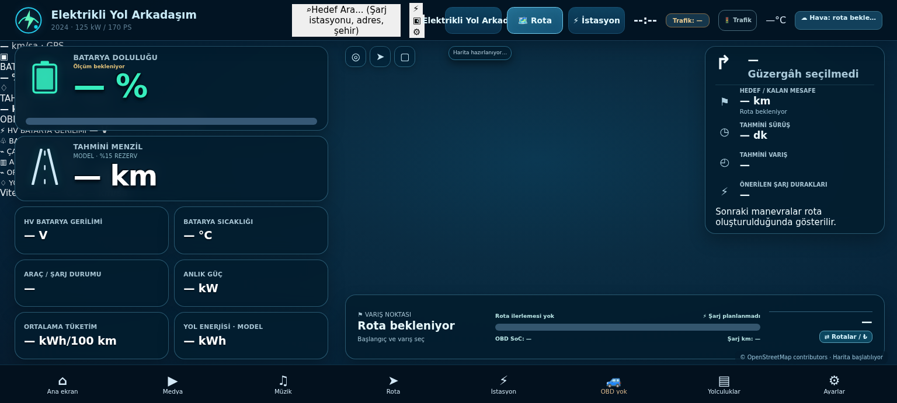
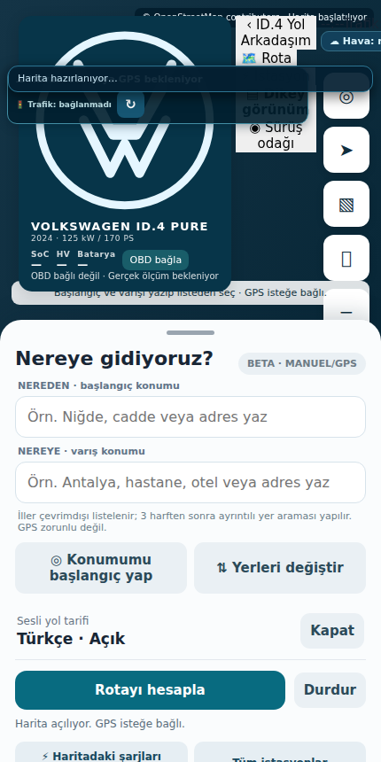
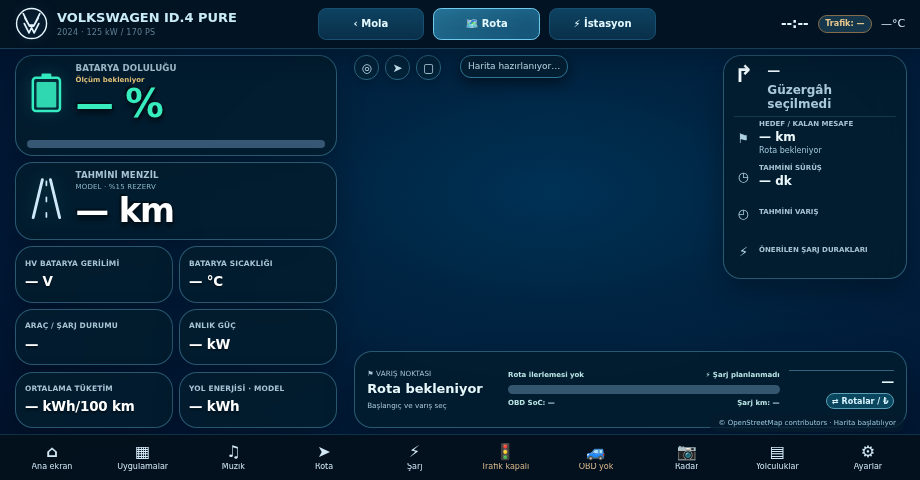

# Elektrikli Yol Arkadaşım

**Elektrikli araçlar için rota, şarj planlama, trafik, gerçek araç verileri ve medya deneyimi.**

> **Geliştirme / test sürümü.** Bağımsız bir açık kaynak uygulama çalışmasıdır; herhangi bir araç üreticisinin resmî ürünü değildir. Fiziksel araç ekranında tüm özelliklerin çalıştığı henüz doğrulanmamıştır.

## Kokpit görünümü

| Telefon görünümü | Kompakt yatay görünüm |
| :---: | :---: |
|  |  |

Bu ekran görüntüleri gerçek uygulama arayüzünden **çevrimdışı tarayıcı testi** ile üretilir. Canlı yol, GPS, OBD ve trafik verisi değildir; gerçek araç içi kullanım kanıtı sayılmaz.

## Özellikler ve doğrulama sınırları

| Modül | Var olan altyapı | Önemli sınır |
|---|---|---|
| **Rota ve harita** | Tek Leaflet haritası, OSRM yol geometrisi ve gerçek alternatif rotalar | Genel OSRM tahmini sürüş süresi canlı trafik süresi değildir |
| **ABRP tarzı rota planı** | Gerçek OSRM rotası + tarihli EPDK CCS koridoru (en fazla 5 km) + model şarj süresi | Gerçek DC sapma süresi, fiyat, doluluk ve varış SoC araçta doğrulanmadı |
| **Sesli yol tarifi** | Android yerel tr-TR TTS, GPS doğruluğu ve yaklaşık eşik kontrollü anons | Cihaz/araç ses odağı ve gerçek yol üzerindeki manevra zamanlaması doğrulanmadı |
| **Canlı trafik** | Kullanıcının kendi anahtarıyla renkli trafik katmanı ve olay sorguları | Servis çağrısı/gerçek karo yüklemesi başarıyla doğrulanmadan “canlı” gösterilmez |
| **Şarj** | EPDK tabanlı istasyon listesi, soket tipi, güzergâh yakınlığı | Anlık soket doluluğu veya tüm operatörlerin güncel ücretleri garanti edilmez |
| **Enerji** | Batarya durumundan türetilen açık etiketli menzil ve tüketim modeli | Model değeri gerçek araç ölçümü gibi sunulmaz |
| **OBD** | İzinli Bluetooth ELM327, salt okunur doğrulanmış veri, veri tazeliği | PID doğrulanmamışsa ekranda `—` gösterilir |
| **Yol ilerlemesi** | Doğrulanmış GPS konumu rota geometrisine izdüşürülür | GPS eski veya rota dışında ise ilerleme ölçülmüş gibi gösterilmez |
| **Medya** | TV, video, müzik, radyo ve diğer mevcut medya motorlarına bağlantı | Üçüncü taraf servislerin üyeliği veya oynatma garantisi verilmez |

### OBD ve sürüş doğruluk sınırları

| Bilgi | Durum |
|---|---|
| BMS SoC, HV voltaj, batarya sıcaklığı | MEB DID araç özelinde henüz doğrulanmadı; `—` |
| Kalan menzil / varış SoC | Sadece belirgin biçimde etiketli model, güncel SoC veya açık kullanıcı senaryosu gerekir |
| Gerçek güç (kW) / ortalama tüketim | Doğrulanmış PID yoksa `—`; model tüketimi ölçüm değildir |
| Veri eskimesi | OBD alan başına 10 saniye; GPS doğruluğu ve yaş kontrolleri ayrıca uygulanır |
| EPDK CCS | 5 km düz-çizgi rota koridoru; yol erişimi/sapma süresi/müsaitlik garantisi yok |
| Sesli manevra | Gerçek Türkçe TTS altyapısı var, fiziksel cihaz ve otomobil testi yapılmadı |
| Android Auto | Doğrulanmadı; araçta çalışıyor iddiası yok |

## Orijinal medya APK 3.2 ile isteğe bağlı entegrasyon

Kullanıcının verdiği `Mola-3.2(3).apk` dosyası değiştirilmeden incelendi:
**sürüm 3.2 / kod 421**, paket kimliği
`me.app.fermataX.auto.mola32.debug`, dışarıdan açılabilir başlatıcı
`me.app.fermatax.auto.PhoneLauncherActivity`.
**SHA-256:** `2cf92adf8df595c97e8ac9b5c9e0d73f64e2e3ce8601756426773f14e50f3f47`.

Bu entegrasyon uygulamaları **birleştirip değiştirilmiş tek APK üretmez**.
Özgün APK'ya kod, imza, kaynak, izin, medya modülü veya arayüz değişikliği
uygulanmaz ve APK repo/CI içine gömülmez.

- Her iki uygulama ayrıca kurulur ve farklı paket kimlikleri nedeniyle yan yana bulunabilir.
- **Elektrikli Yol Arkadaşım → Medya → Orijinal medya uygulamasını aç** tek dokunuşuyla,
  orijinal uygulamanın kendi başlatıcı ekranı açılır; mevcut 15 medya kısayolu aynen kalır.
- Geri dönmek için Android geri tuşu veya son uygulamalar kullanılabilir.
- Özgün uygulama kurulu değilse bilgilendirici hata gösterilir.
- Orijinal uygulamanın tüm menülerine erişilir; iki uygulamanın ortak ekran,
  oturum, çerez, oynatıcı veya dosya sistemine sahip olduğu **iddia edilmez**.
- Gerçek Android telefonunda iki APK'nın birlikte başlatılması **henüz doğrulanmadı**.
- Android Auto'da uygulamalar arası geçiş **doğrulanmadı**.

## APK

GitHub **Actions** bölümünden **Elektrikli Yol Arkadaşım APK** adlı en son başarılı iş akışını aç, **Artifacts → Elektrikli-Yol-Arkadasim-APK** ZIP dosyasını indir ve içindeki APK'yı Android telefona kur.

Yeni debug sürümlerinin imzası farklıysa önceki kurulum üzerine yüklenmeyebilir. Kullanıcı verilerini yedeklemeden uygulamayı kaldırma. Cihaz izinlerini yalnız ilgili özelliğe ihtiyaç duyduğunda ver.

## Kullanım ve güvenlik

- Güzergâh, konum ve trafik servisleri harici sunuculara ağ isteği gönderebilir.
- Gerçek SoC ve sensör değeri yoksa örnek/sabit telemetri kullanılmaz.
- Şarj, hava ve enerji tahmini doğrulanmış araç sensörü değildir.
- Görsel medya araç hareketindeyken sürücü ekranı için kullanılmaz; sürüş kısıtlamaları kaldırılmaz.
- Kişisel trafik servis anahtarı cihazda Android Keystore ile şifreli saklanır. Çalışan istemcinin ağ isteğinde anahtar görünme riski ayrıca bulunabilir.
- Uygulama, otomatik testler başarılı olsa bile fiziksel telefon ve araç testinden geçirilmelidir.

## Teknik entegrasyon

Kaynak dokümandaki rota, OBD ve ilerleme yaklaşımı mevcut kodla uyumlu biçimde uygulanmıştır: tek Leaflet haritası; geçerli OSRM GeoJSON yol geometrisi; Android katmanında gerçek ELM327 olayları; doğruluk ve tazelik kontrolleriyle GPS konumunun rotaya izdüşürülmesi. **İkinci JavaScript köprüsü veya sabit demo verileri eklenmez.**

Ayrıntılar: [Teknik entegrasyon rehberi](docs/ELEKTRIKLI_YOL_ARKADASIM_ENTEGRASYON.md).

## Lisanslar ve veri güvenliği

Bu önizleme sürümü GPL-3.0 lisanslı açık kaynak medya tabanını değişikliklerle birlikte kullanır. Dağıtımda kaynak kod ve üçüncü taraf atıfları korunmalıdır. Tüm hak sahipliği, lisans koşulları ve bağımlılıklar için [LICENSE](LICENSE), [NOTICE.md](NOTICE.md), [THIRD_PARTY_NOTICES.md](THIRD_PARTY_NOTICES.md) ve [trafik anahtarı güvenliği](SECURITY_TOMTOM.md) belgelerine bak.

**Görünen uygulama adı: Elektrikli Yol Arkadaşım.** Geriye dönük uyumluluk nedeniyle bazı eski dahili dosya, sınıf ve paket tanımlayıcıları halen korunur. Bunlar ayrı bir kontrollü geçiş gerektirir; mevcut uygulama güncellemesini bozacak şekilde topluca değiştirilmez.

## Native kokpit UAT: hava durumu, WebView ve PiP

Bu bölüm **:nativecockpit** Kotlin/Compose prototipine aittir; ana Leaflet kokpiti ve özgün Mola servisi değiştirilmez.

- **Open-Meteo:** Doğrulanmış OSRM GeoJSON rotasında başlangıç, her 100 km ve varış konumu örneklenir. `https://api.open-meteo.com/v1/forecast` servisine `current_weather=true` ve `current=temperature_2m,wind_speed_10m,weather_code` istenir; haritada `GeoJsonSource` + `SymbolLayer` sıcaklık ve ikon gösterebilir. `RouteWeatherViewModel` aktif gözlenirken 15 dakikada bir güncelleme dener. Bu **güncel hava modeli** verisidir; varış saatine göre tahmin değildir.
- **Şarj ve hız:** Gerçek rota çizgisine en çok 5 km mesafedeki EPDK **DC** soketli istasyonlar `StationCorridor` ile süzülür; bu yol erişimi veya müsaitlik garantisi değildir. `AutomaticDcChargingPlanner` çıktıları `MODEL/TAHMİN` olarak kalır. `annotations=speed` OSRM yol profili hızıdır, **canlı trafik değildir**.
- **WebView:** Güvenilir Park durumu doğrulanmışsa `MediaWebViewScreen` içinde `https://m.youtube.com` test edilebilir. JavaScript ve DOM storage açıktır; `WebChromeClient.onShowCustomView` tam ekran görüntüye yardımcı olur. Video codec/oturum/DRM desteği cihazda test edilmelidir.
- **Netflix/Disney+/Prime:** WebView DRM engeline takılabilir. Kullanıcı onaylarsa yüklü resmî uygulama açılır; **üçüncü taraf uygulamayı bizim `PictureInPictureParams` ile zorla PiP'e alamayız**. Harici PiP, o uygulama ve Android'in kontrolündedir. Kokpitte `verifiedParked=false` olduğundan, gerçek ve güvenilir Park bağlantısı gelmeden medya testleri **BLOCKED** kalır.
- **TTS:** `TtsDebugLogger` `LANG_MISSING_DATA`, `LANG_NOT_SUPPORTED`, `setLanguage` ve ses hatalarını Logcat'e yazar; Türkçe veri yoksa `TtsPackageWarningDialog` paket yükleme talimatı verir.
- **Tema:** `CustomWarningDialog` yalnız uygulamaya ait uyarılar içindir. Android'in sistem konum izni penceresi Compose ile yeniden temalandırılamaz.

Saha kontrol listeleri: [Native QA / UAT](docs/NATIVE_QA_UAT_TR.md).
