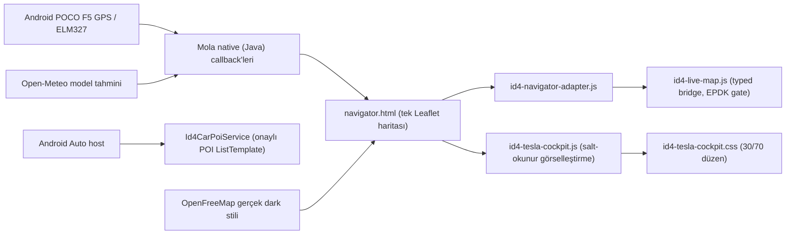

# ID.4 Yol Arkadaşım | Android Auto, Tesla kokpiti ve üretim emniyeti

**Repo:** `AlpTimucin-cpu/ID4-Media-Hub`  
**Dal:** `feature/mola-native-id4`  
**Temel:** Sabitlenmiş GPL Mola kaynağı + yalnız eklemeli ID.4 katmanı  
**Paket:** `me.app.fermataX.auto.id4preview.debug` / sürüm `2.2.2` (CI #846 APK doğrulaması)  
**Durum:** CI başarıları sağlandı; son kod güncellemeleri için yeniden CI ve fiziksel Android Auto/OBD doğrulaması gerekir.  
**NOT:** `debug` paket son eki *Gradle varyantının adıdır*; `debuggable` bayrağı kaynak Gradle yapılandırmasında false. Bu, Google Play'deki test dağıtımı kısıtını kaldırmaz.

## 1) Mimari ve sahiplik sınırları



- **Harita sahibi:** `navigator.html` bir defa `L.map('map',...)` çalıştırır. `window.id4LiveLeafletMap = map` yalnızca referanstır. Yeni kokpit asla `L.map()` oluşturmaz, yeni vektör harita sunucusu icat etmez.
- **Rota sahibi:** Mola'nın `molaRoute`, `molaStations`, `molaPosition`, `molaTelemetry`, `molaCurrentWeather` callback'leri. Adaptör bunları *ilk olarak özgün uygulamaya* iletir.
- **Entegrasyon sahibi:** `id4-navigator-adapter.js` ve `id4-live-map.js` üzerinden tipli, tarihli paket işleme; sonradan eklenen görsel katman bu sözleşmeyi değiştirmez.
- **Üretim kapsamı:** Android WebView telefon kokpiti ve Android Auto için ayrı güvenli `CarAppService`. WebView HTML, Android Auto araç ekranına serbest video/HTML projeksiyonu yetkisi sağlamaz.
- **Multimedya:** Mola'nın orijinal oynatıcı/servisleri ve rota kartları korunur. Android Auto sürüş ekranında medya/video projeksiyonu iddiası yapılmaz.

### Kodun tamamı (referans dosyalar)

| Dosya | Görev |
| --- | --- |
| [`navigator.html`](../mola-native/overlay/fermata/src/main/assets/id4/navigator.html) | WebView ekranı, tek Leaflet instance, orijinal native callback'ler |
| [`id4-navigator-adapter.js`](../mola-native/overlay/fermata/src/main/assets/id4/id4-navigator-adapter.js) | Tipli Android→JS köprüsü, özgün callback önceliği |
| [`id4-live-map.js`](../mola-native/overlay/fermata/src/main/assets/id4/id4-live-map.js) | Rota ekleri, 30 saniye TTL, EPDK ülke-kapsamı atomik güvenlik kilidi |
| [`id4-basemap.js`](../mola-native/overlay/fermata/src/main/assets/id4/id4-basemap.js) | OpenFreeMap `dark` ve `liberty` vektör stilleri |
| [`id4-tesla-cockpit.css`](../mola-native/overlay/fermata/src/main/assets/id4/id4-tesla-cockpit.css) | 30/70 siyah kokpit; blur kontroller; düşük SoC uyarısı |
| [`id4-tesla-cockpit.js`](../mola-native/overlay/fermata/src/main/assets/id4/id4-tesla-cockpit.js) | Salt-okunur SoC/hız/vites/hava gözlemcisi |
| [`Id4CarPoiService.java`](../mola-native/overlay/fermata/src/auto/java/me/aap/fermata/ev/Id4CarPoiService.java) | Android Auto POI istasyon listesi, yerel OBD ekranına erişim |
| [`patch_mola.py`](../mola-native/patch_mola.py) | Pinlenmiş Mola kaynağına kontrollü overlay |
| [`build-mola-native-id4.yml`](../.github/workflows/build-mola-native-id4.yml) | Test → Gradle → compiled APK doğrulama → ZIP artifact |

## 2) Android Auto Manifest ve `automotive_app_desc.xml`

**Main manifest** (mevcut kaydı ikinci kez ekleme):

```xml
<application>
    <!-- Google Play services / Android Auto uygulama keşfi. -->
    <meta-data
        android:name="com.google.android.gms.car.application"
        android:resource="@xml/automotive_app_desc" />
</application>
```

**Auto manifest / uygulama etiketi altında:**

```xml
<!-- Gerçekte bulunan Java CarAppService; sürüş ekranındaki POI şablonu. -->
<meta-data
    android:name="androidx.car.app.minCarApiLevel"
    android:value="5" />

<service
    android:name="me.aap.fermata.ev.Id4CarPoiService"
    android:enabled="true"
    android:exported="true"
    android:label="ID.4 Yol Arkadaşım"
    android:icon="@drawable/id4_launcher">
    <intent-filter>
        <action android:name="androidx.car.app.CarAppService" />
        <category android:name="androidx.car.app.category.POI" />
    </intent-filter>
</service>
```

**Auto `res/xml/automotive_app_desc.xml`** (Mola desteği korunur):

```xml
<?xml version="1.0" encoding="utf-8"?>
<automotiveApp xmlns:tools="http://schemas.android.com/tools">
    <!-- Mevcut Mola medya altyapısını kaldırma. -->
    <uses name="media" />
    <!-- Car App Library UI şablonlarını etkinleştir. -->
    <uses name="template" />
    <!-- Kaynak Mola varyantının mevcut bildirimleri. -->
    <uses name="service" tools:ignore="InvalidUsesTagAttribute" />
    <uses name="projection" tools:ignore="InvalidUsesTagAttribute" />
</automotiveApp>
```

**Yasak sahte tanımlamalar:** `androidx.car.app.category.NAVIGATION` yalnızca gerçek bir `NavigationTemplate` / navigasyon `CarAppService` uygulandığında kullanılmalı. `android.intent.category.CAR_LAUNCHER`, Android Auto'nun park Activity'leriyle ilgilidir; bu POI servisinin intent filtresine eklenmemeli. **Bilinmeyen kaynaklar** anahtarı Car App Library uygulamalarını güvenilir kaynak şartından muaf tutmaz. Gerçek araç testi için Google Play Internal App Sharing / Internal Testing veya geliştirme aşamasında DHU kullanılmalıdır.

Resmî kaynaklar:
- https://developer.android.com/training/cars/apps/auto
- https://developer.android.com/training/cars/apps/navigation
- https://developer.android.com/training/cars/testing

## 3) WebView DOM ve CSS sözleşmesi

Sayfa yükleme sırası (`navigator.html`): (1) Leaflet/MapLibre, (2) mevcut native Mola sayfa script'i ve **tek `map`**, (3) `id4-live-map.js`, (4) `id4-navigator-adapter.js`, (5) **yalnız yeni görsel gözlemci** `id4-tesla-cockpit.js`.

```html
<!-- Yeni id'ler eklenir; co-soc, co-trip-*, map, sheet, dock id'leri korunur. -->
<link rel="stylesheet" href="id4-tesla-cockpit.css" />

<aside id="id4-tesla-side" class="id4-tesla-side">
  <section class="id4-tesla-card">
    <div class="id4-tesla-caption">Hız · GPS</div>
    <strong id="id4-drive-speed">—</strong>
    <div id="id4-drive-gear">Vites: —</div>
  </section>

  <section class="id4-tesla-card id4-tesla-battery">
    <div class="id4-tesla-caption">Batarya doluluğu · OBD</div>
    <strong id="id4-side-soc">— %</strong>
    <div class="id4-progress"><div id="id4-side-bar-fill"></div></div>
    <div id="id4-energy-impact" hidden></div>
  </section>

  <section class="id4-tesla-card">
    <div class="id4-tesla-caption">Dış hava · Open-Meteo modeli</div>
    <strong id="id4-side-temp">— °C</strong>
    <strong id="id4-side-wind">— km/sa</strong>
  </section>
</aside>

<!-- Mevcut testli tek Leaflet haritası:
     <div id="map"></div> kaydını ASLA ikinci defa ekleme! -->
<script src="id4-live-map.js"></script>
<script src="id4-navigator-adapter.js"></script>
<script src="id4-tesla-cockpit.js"></script>
```

Asıl CSS kaynak dosyası koyu tema, `#map{inset:0 0 0 30%;width:70%;height:100vh}`, #111111 panel, şeffaf/buzlu denetimler, erişilebilir pil yüzdesi ve `max-height:440px` sıkıştırılmış ekran düzenlerini içerir. Kullanılan OpenFreeMap `dark` stili **vektör kaynağının kendi stilidir**; çakışan CSS ile vektör harita renklerini tersine çevirmeyiz. `co-soc` ve test edilen eski DOM alanlarının görünürlük kontratını korumak için eski sol panel `opacity:0;pointer-events:none` kullanır; yeni veriler ayrı `id4-*` alanlarına yansıtılır.

## 4) Tipli Native/JS veri modelleri (dokümantasyon sözleşmesi)

Aşağıdaki TypeScript **şema açıklamasıdır**, projeye yeni TypeScript derleme bağımlılığı getirmez.

```ts
// JS köprüsünün izinli komutları:
// ID4NativeBridge.receive('route'|'stations'|'gps'|'telemetry'|'status', packet)

type Route = {
  coordinates: Array<[number, number]>; // mevcut Mola rotası
  distanceKm?: number;
  durationMin?: number;
  stopIncluded?: boolean;
};

type NativeGps = {
  lat: number; lon: number; accuracy: number;
  timeMs: number;               // Unix milisaniye, <=30s bayatlama limiti
  speedKmh?: number;            // yalnız doğrulanmış GPS ölçümü
};

type NativeTelemetry = {
  fresh: boolean;               // native doğrulamasından gelen bayrak
  soc?: string | number;        // ör. "64 %" / 64, [0..100] dışında reddedilir
  voltage?: string; temperature?: string;
  chargeMode?: string;          // vites değildir
  gear?: 'P'|'R'|'N'|'D'|'B';     // ancak gearVerified=true ise gösterilir
  gearVerified?: boolean;
};

type CurrentWeather = {
  modelBased: true;
  temperature: number;          // Open-Meteo hava tahmini; batarya ısısı değildir
  wind: number;                 // km/sa
  precipitation: number;
  modelTime: number;            // Unix saniye
  receivedAt: number;           // Unix milisaniye
};

// Ülke düzeyi şarj verisi (rota altkümesi bunun yerine GEÇEMEZ).
type EpdkCountryBatch = {
  metadata: {
    source: 'EPDK'; coverage: 'country'; complete: true;
    verifiedAtUtc: string; geocodedCount: number; // >=5000 ve length ile eşit
  };
  stations: Array<{
    id: string|number;
    coordinates: {lat:number; lng:number};
    socketType: 'AC'|'DC';
    power_kw: number;             // >0, <=1000, doğrulanmış sayı
    currentStatus: 'unknown'|'available'|'occupied'|'offline'|'out_of_service';
    statusObservedAtUtc?: string; // available/occupied için <=15 dk
  }>;
};
```

### Salt-okunur görsel gözlemci / fail-safe örneği

```js
// Farklı sorumluluklar:
// * Mola callback'i rotayı çizer ve esas durumu yönetir.
// * Tesla katmanı doğrulanmış yeni veriyi yalnızca gösterir.
// * Önceki callback hata atsa da yeni HUD yüzünden WebView çökmez.
function observe(name, after) {
  try {
    const original = window[name];
    if (typeof original !== 'function') return false;
    if (original.__id4TeslaObserver === true) return true;
    const wrapped = function (packet) {
      let result;
      try { result = original.apply(this, arguments); }
      catch (error) { console.warn('Mola callback failed', name, error); }
      try { after(packet); }
      catch (error) { console.warn('ID4 visual observer failed', name, error); }
      return result;
    };
    wrapped.__id4TeslaObserver = true;
    window[name] = wrapped;
    return true;
  } catch (error) {
    console.warn('ID4 observer installation refused', error);
    return false;
  }
}

// Gerçek üretim sürümünde bu işlevin eksiksiz, test edilmiş hâli
// id4-tesla-cockpit.js dosyasında bulunur.
```

**Zaman ve güvenlik sınırları:**

| Veri | Kabul/güncellik | Hatalı/eski davranışı |
| --- | --- | --- |
| Araç SoC | Yalnız `fresh===true`, sayısal `0..100`, alınan paket yaşı **<30s** | `— %`, pil barı 0; menzil/şarj önerisi türetilmez |
| GPS hızı | Türkiye koordinatları, doğrulanmış konum, hassasiyet <=35m, `speedKmh` tam sayı `0..252`, fix yaşı **<30s** | `— km/sa`; sıfır hızı uydurulmaz |
| Vites | Ayrı `gearVerified===true` + `P/R/N/D/B` | `Vites: —`; `chargeMode` vites sayılmaz |
| Hava | Kaynak `Open-Meteo`, `modelBased===true`, sağlıklı sıcaklık/rüzgâr, kaynak/teslim zamanları <=90dk | `—`, `model tahmini` etiketi |
| Düşük SoC | Güncel doğrulanmış `soc < 20` | Yalnız kırmızı pil ve harita çerçevesi; ulusal DC kilidi açılmaz |
| Ülke düzeyi DC | Tam EPDK sözleşmesi, 5.000+ benzersiz kaydın tümü doğrulanır; dosya <=72s; bilinen doluluk <=15dk | **Fail closed**: eski kabul edilmiş ulusal DC indeksi bile temizlenir |
| Rota çevresi şarj | Mola `kind:'route'` / koridor kartları | Ulusal indeks yerine konmaz; mevcut Mola kartları korunur |

Not: Hava koşullarının menzile etkisi mevcut enerji modelindeki tek çarpanla hesaplanır; görsel katman ikinci çarpan uygulamaz.

## 5) Regresyon testleri ve sürüm kapıları

**CI aşamaları:**

1. Sabitlenmiş Mola upstream SHA'ları doğrulanır. Bilinmeyen upstream sürüme patch uygulanmaz.
2. `patch_mola.py` eklemeli çalışır; medya/oynatıcı modülleri değişmemiş olmalı.
3. `test_android_auto_manifest.py`: meta-data tek, `Id4CarPoiService` mevcut ve exported, POI kategorisi, media + template kayıtları korunmuş.
4. `test_live_map.js`: 5km koridor, doğrulanmış EPDK tam paket, 30s GPS/SoC sınırı, tek hava çarpanı.
5. `test_id4_native_bridge.js`: tipli mesaj, bozuk JSON reddi, Mola callback fırlatsa da çökmeden devam, başarısız ulusal EPDK transferi sonrası DC kilidi kapalı.
6. `test_tesla_cockpit.js`: sahte hız/SoC yok, vites doğrulaması, <20% eşik, bayat verinin silinmesi, bozuk paket ve çoklu başlangıç testleri.
7. `test_navigator.js`: adres önerileri, rota alternatifleri, Mola katmanları, rota hava kartları.
8. Playwright `test_cockpit_layout.cjs` dört boyut (1536x864,1536x691,920x414,873x393). Görüntüde taşan kart ve JS hatası olmamalı.
9. `test_vector_map.cjs`: OpenFreeMap temeli.
10. Java enerji, şarj danışmanı, geçmiş, EPDK soket ve OBD güvenlik testleri.
11. Gradle `packageAutoDebugUniversalApk`; APK asset listesi ve **birleştirilmiş binary Manifest içindeki gerçek CarAppService** doğrulanır.
12. `Mola-ID4-Preview.apk` ve `SHA256.txt` GitHub Actions artifacts olarak yüklenir.

CI **#846**, `b562fa17` commit'i için tüm adımlarla başarılıdır; onun oluşturduğu APK'nın SHA-256 özeti:
`4fab53781377372cdf9d9a06fa06db19b4941f15bb51dc64d10d698d3afb13b6`.
Sonraki düzeltmeler için **ayrı ve güncel CI sonucu gereklidir**. SHA'yı yalnız karşılık geldiği APK için kullanın.

## 6) POCO F5 + VW ID.4 fiziksel doğrulama planı

```powershell
$adb = "C:\Users\Alp\Desktop\platform-tools\adb.exe"
$apk = "C:\KULLANICI\INDIRILENLER\Mola-ID4-Preview.apk"

# Android Auto için önce Play Internal App Sharing/Testing kurulum yolu önemlidir.
# Yerel adb install, Android Auto host'un güvenilir paket politikası için kanıt DEĞİLDİR.
& $adb devices -l
& $adb install -r $apk
& $adb shell pm list packages | Select-String "id4preview|mola32"
$pkg = "me.app.fermataX.auto.id4preview.debug"
& $adb shell dumpsys package $pkg |
  Select-String "Id4CarPoiService|CarAppService|category.POI" -Context 2,3
```

**Sürüm dağıtım kapıları (Go/No-Go):**
- GitHub CI tam yeşil; APK binary Manifest ve imza/kimlik doğrulanmış.
- Telefonda açılış, ekran döndürme, konum reddi, internet yokluğu, harita kaynağı düşmesi ve OBD bağlı/değil durumlarında çökmüyor.
- 30 saniye boyunca GPS/SoC paketi yoksa tüm canlı alanlar `—` oluyor.
- Eksik ülke EPDK verisiyle en yakın ulusal DC gösterilmiyor; Mola rota istasyon kartları çalışıyor.
- Gerçek Android Auto host'ta POI servisinin keşfi **güvenilir Play test dağıtımıyla** doğrulanıyor. Sahte NAVIGATION / CAR_LAUNCHER bildirimi eklenmiyor.
- Hareket halinde erişilemeyen özellikler ve güvenlik kuralları korunuyor; medya ve özel WebView haritası Android Auto'ya izinsiz projekte edilmiyor.
- Kamu OSRM demo endpoint'i üretime yönelik SLA değildir; uygulamanın gerçek kullanımı için güvenilir/izinli rota sağlayıcısı ve servis limitleri çözülmeli.

**Kesin sonuç:** Mimari ve CI kontrolleri release-candidate seviyesindedir. Son yazılım düzenlemelerinin CI sonucunu ve fiziksel Android Auto/OBD testini görmeden `production ready` olarak işaretlemeyin.
